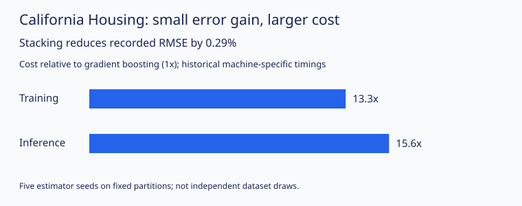

<div align="center">
  <h3>Tree Ensemble Benchmark</h3>
  <p>
    Decision trees and ensemble learning with <strong>NumPy CART</strong>,
    <strong>out-of-fold stacking</strong>, and accuracy–cost comparisons.
    <br />
    <a href="#-getting-started"><strong>Quick Start »</strong></a>
  </p>
  <p>
    
    
    
    
  </p>
</div>

## 🔍 About The Project

This project compares tree-based models on **Fashion-MNIST classification** and
**California Housing regression**. It includes a CART classifier implemented from
scratch in NumPy and benchmarks scikit-learn ensembles, from bagging and random
forests to gradient boosting and stacking.

The main finding: a small improvement in prediction quality can come at a much
higher computational cost. On the recorded Housing benchmark, stacking reduced
RMSE by **0.29%** compared with gradient boosting, with approximately **13× fitting
cost and 16× prediction cost**.

## 🛠 Built With

- **Language:** Python 3.11+
- **Algorithms:** NumPy CART, scikit-learn tree ensembles
- **Testing:** pytest

## 📐 Architecture

- **CART from scratch:** Gini/entropy splitting, sorted-feature searches,
  depth/leaf constraints and class probabilities.
- **Ensemble comparison:** bagging, random forests, Extra Trees, AdaBoost,
  gradient boosting, voting and stacking.
- **Out-of-fold stacking:** five training-only folds with checks for missing,
  duplicate or overlapping prediction assignments.
- **Evaluation:** fixed train/validation/test splits, five estimator seeds,
  predictive metrics, fitting time, prediction latency and tree node counts.

```text
├── main.py                 # Run experiments
├── src/                    # CART, ensembles, data and evaluation
├── tests/                  # Correctness and isolation checks
├── results/                # Historical and separately reproduced results
├── figures/                # Accuracy–cost comparison
├── requirements.txt
├── EXPERIMENTS.md           # Methodology, data sources and limitations
└── VALIDATION.md            # Verification notes
```

## 🚀 Getting Started

Python 3.12 is recommended. No GPU is required.

```sh
git clone https://github.com/EnzoPicarel/tree-ensemble-benchmark.git
cd tree-ensemble-benchmark
python3 -m venv .venv
source .venv/bin/activate
pip install -r requirements.txt
python main.py quick --output runs/quick
```

The quick experiment uses small generated datasets and requires no downloads.
Choose a new output directory when running it again.

## ⚡ Execution

```sh
# Compare NumPy CART with scikit-learn on 90 synthetic configurations.
python main.py cart --output runs/cart

# Check historical results and regenerate the figure.
python main.py report --output runs/report

# Run the expensive full benchmark; downloads the public datasets.
python main.py full --download --output runs/full
```

See [EXPERIMENTS.md](EXPERIMENTS.md) for model configurations, dataset sources,
splits, output files and evaluation limitations.

## 📊 Results

| Dataset | Model | Recorded mean test result |
|---|---|---:|
| Fashion-MNIST | OOF stacking | 86.62% accuracy ± 0.0925 percentage points |
| California Housing | Gradient boosting | 0.47249 RMSE |
| California Housing | OOF stacking | 0.47110 RMSE |

These are historical results across five estimator seeds on fixed partitions.
The SD does not measure variability across independent datasets. Housing RMSE
uses units of $100,000. The complete five-seed campaign has not been rerun;
the separate Housing seed-42 and 90-configuration CART reruns match the recorded
metrics. See [VALIDATION.md](VALIDATION.md).



The timing ratios are machine-specific. Gradient boosting remains a simpler option
when the small RMSE improvement does not justify stacking's additional cost.

## 🧪 Tests

```sh
pip install -r requirements-dev.txt
python -m pytest tests -q
```

## 👥 Author

- **Enzo Picarel**
